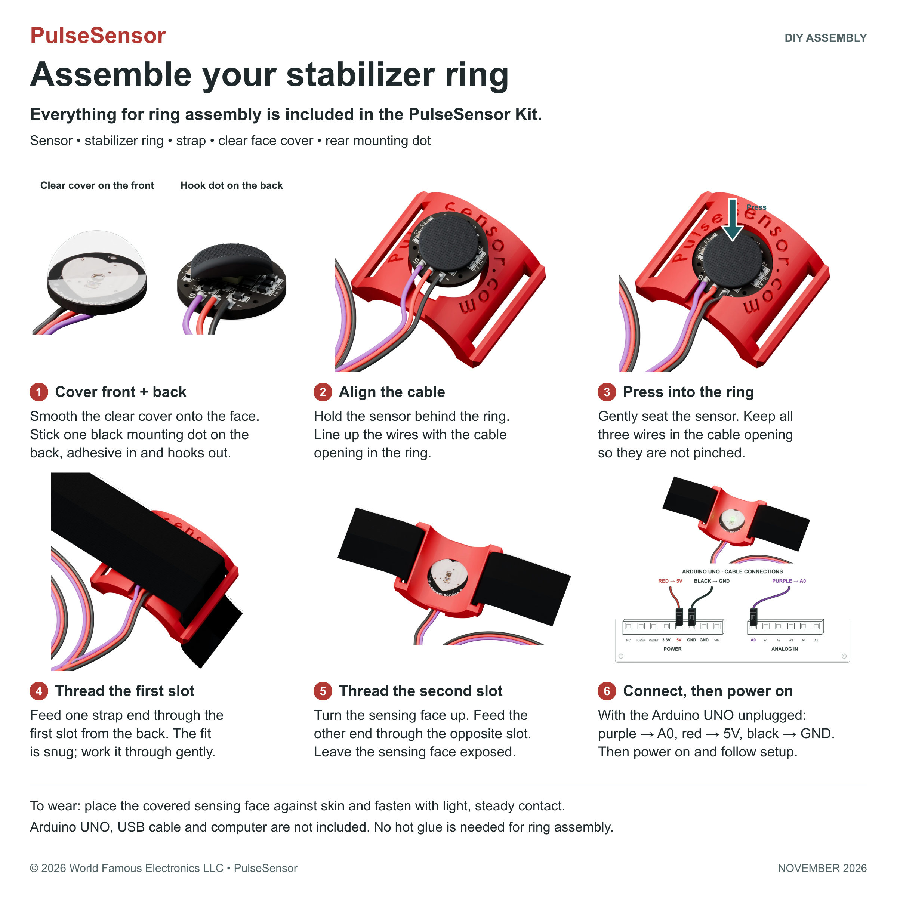
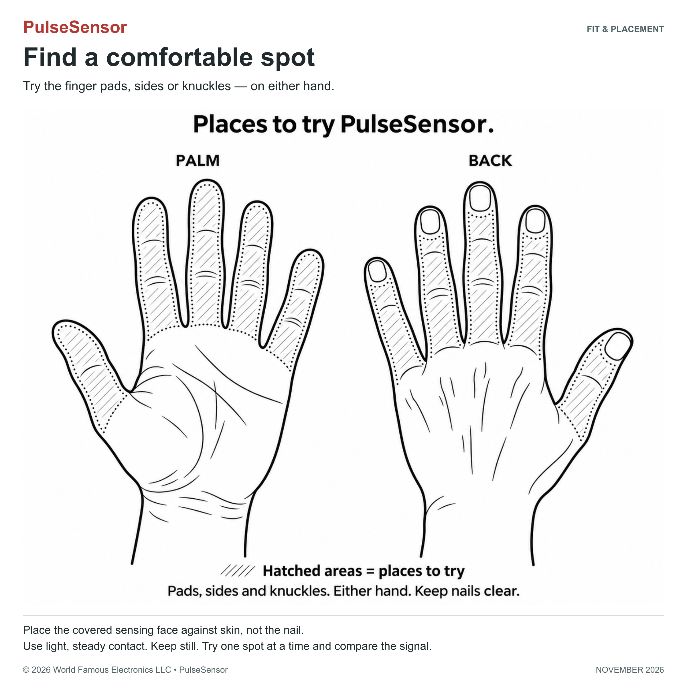
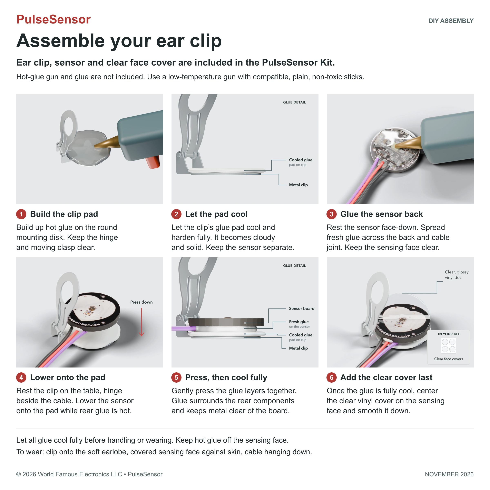

## [PulseSensor.com](https://pulsesensor.com) Playground

Ready-to-use Arduino code for your PulseSensor. See your first pulse wave, calculate BPM, or make something respond to your heartbeat. 💓

**Start here:** [Assemble your kit](#assemble-your-pulsesensor-kit), then install **PulseSensor Playground** in Arduino Library Manager, open [GettingStartedProject](examples/GettingStartedProject/GettingStartedProject.ino), then try [PulseSensor_BPM](examples/PulseSensor_BPM/PulseSensor_BPM.ino) once your waveform is steady.

- Commented examples help you get started and keep experimenting. 🤘
- Switch projects right in the Arduino IDE. 💻
- Share what you make with the community. 🐝

---

## Assemble your PulseSensor kit

Choose the **stabilizer ring** for finger placement or the **ear clip** for earlobe placement. Follow the preparation steps before putting the sensor against your skin.

[Ring assembly](#stabilizer-ring--no-glue-needed) · [Ear-clip assembly](#ear-clip--hot-glue-required) · [All assembly steps in text](docs/assembly/README.md)

### Stabilizer ring — no glue needed

Everything needed for ring assembly is included in the current PulseSensor Kit: sensor, stabilizer ring, strap, clear face cover, and rear mounting dot.

[Read the ring steps on GitHub](docs/assembly/README.md#stabilizer-ring) · [Full ring guide on PulseSensor.com](https://pulsesensor.com/pages/ring-prep)

### Find a comfortable spot on either hand

Try the pads, sides, or knuckles of your fingers on either hand. Place the covered sensing face against skin, not the nail. Use light, steady contact and keep your hand still. Try one spot at a time and compare the signal.

### Ear clip — hot glue required

The ear clip, sensor, and clear face cover are included in the kit. **A hot-glue gun and glue are required and are not included.** Use a low-temperature gun with compatible, plain, non-toxic glue sticks. Keep glue off the sensing face and let all glue cool fully before handling or wearing.

[Read the ear-clip steps on GitHub](docs/assembly/README.md#ear-clip) · [Full ear-clip guide on PulseSensor.com](https://pulsesensor.com/pages/earclip-prep)

A compatible development board, USB data cable, and computer are not included in the kit. The wiring shown is for an **Arduino UNO**; use the correct analog pin and voltage for other boards. Click either instruction image to view it at full size.

Assembly guides © 2026 World Famous Electronics LLC · PulseSensor. Updated November 2026.

---

## Buy PulseSensor

- **United States:** [Buy the PulseSensor kit on Amazon](https://www.amazon.com/dp/B01CPP4QM0).
- **International:** Buy from [SparkFun](https://www.sparkfun.com/pulse-sensor.html) or [Adafruit](https://www.adafruit.com/product/1093).
- **Education & Bulk:** [Request a bulk quote](https://pulsesensor.com/pages/school-bulk-orders). 50-kit minimum, in increments of 25 kits.

---

## Connecting the Hardware 😎

Easy setup: prepare, connect, and get a steady signal

### 1. Prepare your sensor

The current kit includes the **TPU Stabilizer Ring**, Velcro finger strap, ear clip, and transparent vinyl insulation dots. You'll also need a compatible development board, a USB data cable, and a computer.

Before skin contact, follow the [ring or ear-clip assembly steps](docs/assembly/README.md), including the clear front cover and the rear preparation for your chosen mount. The ring holds the sensor steady; it does not replace the preparation steps. The illustrated guides are also [visible above](#assemble-your-pulsesensor-kit).

### 2. Connect the three wires

For the **Arduino Uno GettingStartedProject**:

| PulseSensor wire | Arduino Uno connection |
| --- | --- |
| Purple — signal | `A0` |
| Red — power | `5V` |
| Black — ground | `GND` |

Using another board? Follow its example's analog pin and voltage instructions. PulseSensor needs an analog input (ADC); a 5V Uno wiring diagram does not apply to every board.

### 3. Hold it gently

After preparation, position the sensor with the ring, strap, or ear clip. Rest your hand, keep the cable from pulling, and use light, steady contact. Load the Getting Started example below and look for a repeating waveform before moving on to BPM.

## Loading the Playground

Install the library and see your first pulse wave 🤓

1. Install [Arduino IDE](https://www.arduino.cc/en/software/) if you don't already have it.
2. Open **Tools → Manage Libraries…**, search for **PulseSensor Playground**, and click **Install** or **Update**.
3. Open **File → Examples → PulseSensor Playground → GettingStartedProject**.
4. Select your board and USB port, then upload the sketch. For other boards, use the matching [board-specific example](https://pulsesensor.com/pages/installing-our-playground-for-pulsesensor-arduino).
5. Open **Tools → Serial Plotter** and select **115200 baud** for `GettingStartedProject`.
6. Hold the prepared sensor gently against your fingertip. Give the signal 5–10 seconds to settle; look for a repeating pulse wave and the built-in LED blinking as the signal crosses the threshold.

Ready for BPM? Open [PulseSensor_BPM](examples/PulseSensor_BPM/PulseSensor_BPM.ino) and follow the [BPM tutorial](https://pulsesensor.com/pages/getting-advanced).

[Getting Started tutorial](https://pulsesensor.com/pages/code-and-guide) · [Library and example guide](https://pulsesensor.com/pages/installing-our-playground-for-pulsesensor-arduino)

## Web Serial Signal Coach

See your pulse in the browser with Signal Coach

[Open Signal Coach](https://pulsesensor.com/pages/signal-coach) for a live waveform and guidance on sensor placement in desktop Chrome or Edge.

Upload the [Web Serial example](examples/SignalCoachWebSerial/SignalCoachWebSerial.ino), close Arduino Serial Monitor and Serial Plotter, select **50 samples/s**, then click **Connect**. The website walks you through setup.

Want to run it locally or change the code? See the [full source and home-build guide](docs/signal-coach/README.md).

## Playground Project Descriptions

Tinker and experiment with popular projects 👩🏽‍💻👩🏻‍🔬

### The Getting Started Project
  See your raw pulse wave in Serial Plotter and blink the built-in LED.

- [**Project Page**](https://pulsesensor.com/pages/code-and-guide)

  
---

### Calculate BPM
  Calculate beats per minute (BPM) once you have a steady raw waveform.

- [**Project Page**](https://pulsesensor.com/pages/getting-advanced)

  
---

### Make a Sound with Your Heartbeat
  Transform the heartbeat into a live "beep" with a speaker.

- [**Project Page**](https://pulsesensor.com/pages/pulse-sensor-speaker-tutorial)

  
---

### Move a Motor with Your Heartbeat
  Make a servo motor pulse to your live heartbeat.

- [**Project Page**](https://pulsesensor.com/pages/pulse-sensor-servo-tutorial)

  
---

### Connect Two (or More) Pulse Sensors
  Use 2 or more Pulse Sensors on one Arduino.

- [**Project Page**](https://pulsesensor.com/pages/two-or-more-pulse-sensors)

  
---

### Processing Visualizer

  Visualize the pulse waveform and BPM from your Arduino in Processing.

- [**Project Page**](https://pulsesensor.com/pages/processing-visualization)

  

---

### Pulse Transit Time

  Explore pulse timing differences with two PulseSensors. This is an educational experiment, not a blood-pressure measurement.

- [**Project Page**](https://pulsesensor.com/pages/pulse-transit-time)

  

---

## Developer Resources

Functions, board examples, troubleshooting, and support

### Build on the examples

- [PulseSensor Playground function guide](resources/PulseSensor%20Playground%20Tools.md)
- [All example sketches](examples/)
- [Board-specific examples and library reference](https://pulsesensor.com/pages/installing-our-playground-for-pulsesensor-arduino)

### Troubleshooting your signal

Start with the raw waveform in `GettingStartedProject`:

- **Flat signal?** Check power, ground, the analog pin, and the selected board and port.
- **Noisy signal?** Rest your hand, ease the pressure, reduce strong ambient light, and reseat the prepared sensor in the ring or strap.
- **Extra or missed beats?** Get a steady waveform first, then adjust the threshold in your example. In `GettingStartedProject`, it is `Threshold`; other examples may use `THRESHOLD` or `setThreshold()`.
- **Serial port busy?** Close other serial tools before opening Serial Plotter or Signal Coach.

[More setup help](https://pulsesensor.com/pages/start)

### Give and get feedback

For setup help, email [support@pulsesensor.com](mailto:support@pulsesensor.com) with your board, example name, wiring photo, and Serial Plotter screenshot. Report reproducible library bugs in [PulseSensorPlayground Issues](https://github.com/WorldFamousElectronics/PulseSensorPlayground/issues).

---

For educational and experimental use. PulseSensor is not a medical device.

PulseSensor.com® · World Famous Electronics LLC · [MIT License](LICENSE)
