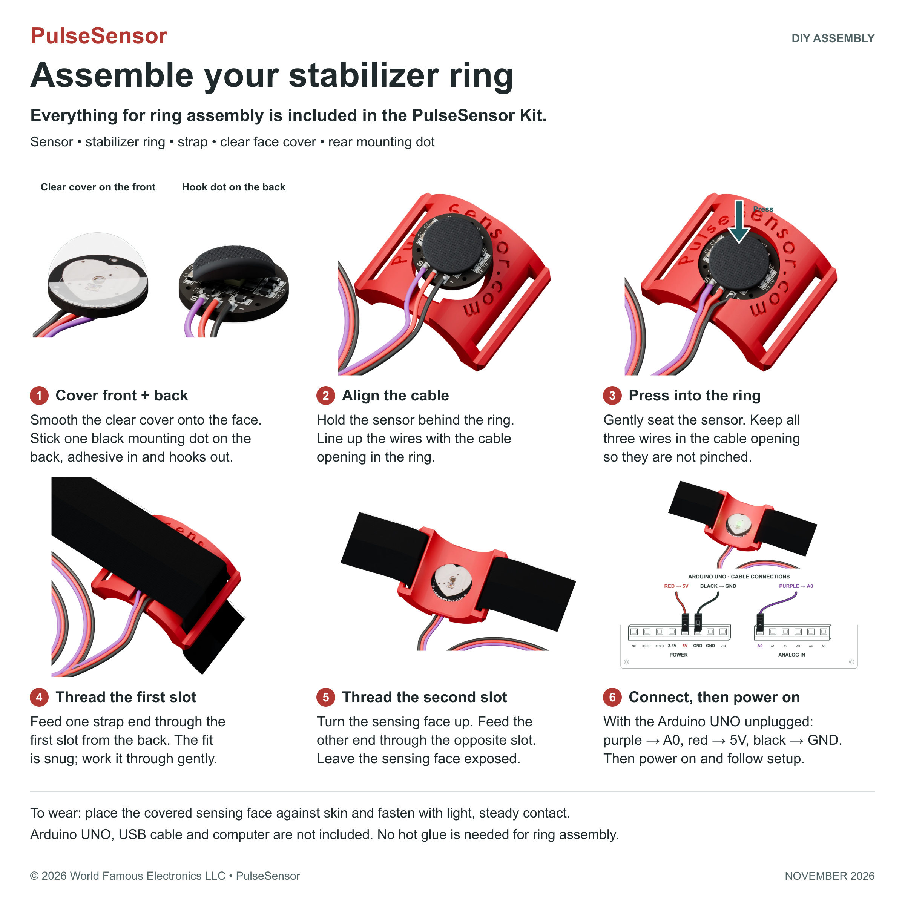
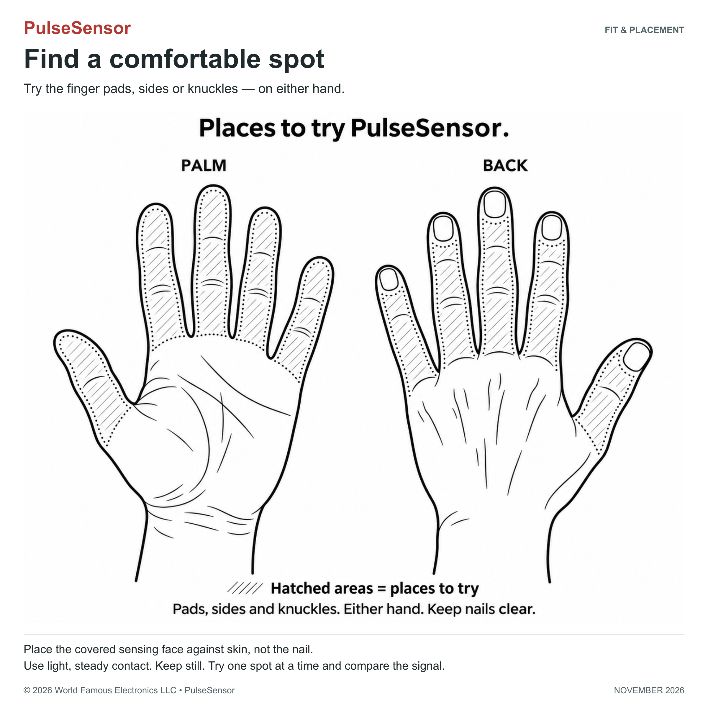
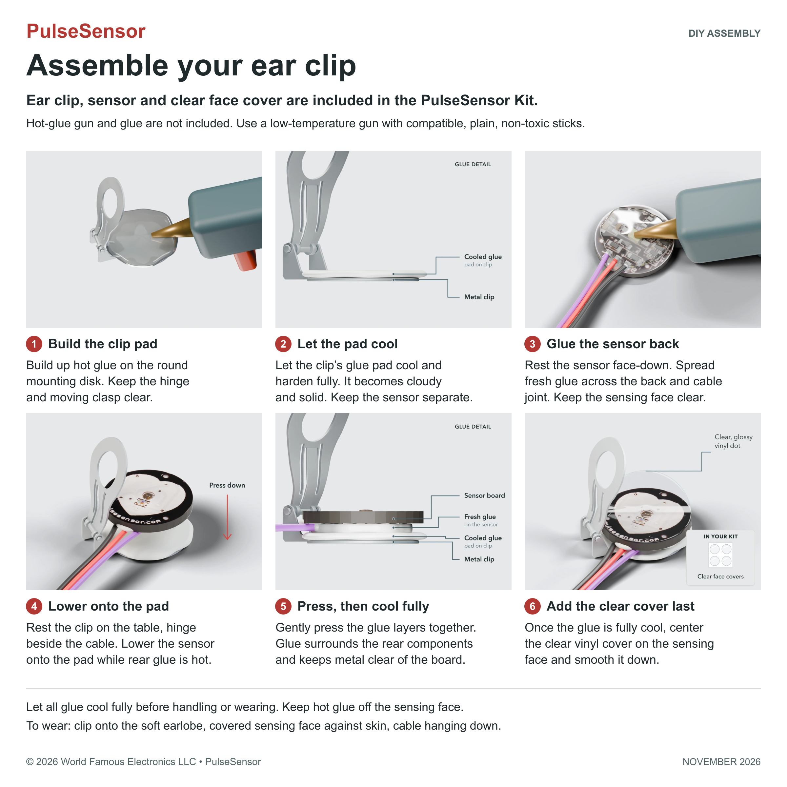

# PulseSensor kit assembly

[Back to the repository README](../../README.md) · [Stabilizer ring](#stabilizer-ring) · [Ear clip](#ear-clip)

These are the instructions for the current PulseSensor Kit. The graphics and text are stored in this repository so you can follow them on GitHub or in a downloaded copy. Choose one mounting method and complete its preparation before skin contact.

## Stabilizer ring

**Everything needed for ring assembly is included. No glue is needed.** You will use the PulseSensor with its attached cable, red stabilizer ring, black strap, one clear vinyl face cover, and one rear hook mounting dot.

1. **Cover the front. Add the rear dot.** Center the clear vinyl cover on the sensing face and smooth it flat. Turn the sensor over. Press the adhesive side of the black mounting dot onto the back, with the hooks facing out.
2. **Align the keyed opening.** Hold the sensor behind the red ring. Line up the cable with the ring's cable opening.
3. **Press the sensor into place.** Gently press the sensor into the ring. Keep all three wires in the cable opening so they are not pinched.
4. **Thread from the back.** Feed one end of the strap through the first slot from the back. The fit is snug; work the strap through the opening.
5. **Thread the second slot.** Turn the ring over so the sensing face points up. Feed the other end through the opposite slot. Leave both ends open, with the sensing face exposed, ready to fit on your finger.
6. **Connect Arduino, then power on.** With your Arduino UNO unplugged, connect purple to A0, red to 5V, and black to GND. Then power it on and follow the code and setup guide. The UNO, its USB cable, and a computer are not included in the kit.

### Fit and placement

Place the covered sensing face against your skin. Fasten the strap with light, steady contact, then keep your hand still while checking the signal. Try the pads, sides, or knuckles of your fingers, on either hand. Place the sensing face against skin, not the nail. Try one spot at a time and compare the signal.

[Full ring guide and placement illustrations on PulseSensor.com](https://pulsesensor.com/pages/ring-prep)

## Ear clip

**The ear clip, sensor, and clear face covers are included. A hot-glue gun and glue are required and are not included.**

Use a small craft glue gun on low heat. Avoid large industrial guns and high-heat settings. Choose plain glue sticks marked non-toxic and made for your gun's size and temperature; skip glitter and other fillers. Let glue cool fully before touching it.

1. **Build the pad on the clip.** Build up hot glue on the round mounting disk. Keep the hinge and moving clasp clear.
2. **Let the clip pad cool.** Let the glue on the clip cool and harden fully. It becomes cloudy and solid. Leave the sensor separate.
3. **Add fresh glue to the back.** Rest the sensor face-down. Spread fresh hot glue across the back and cable joint, around the rear components. Keep the sensing face clear.
4. **Press the sensor down.** Rest the clip on the table, hinge beside the cable. Gently lower the sensor onto the cooled pad while its rear glue is hot.
5. **Join the two glue layers.** Gently press the broad fresh glue into the cooled clip pad. Glue surrounds the rear components and keeps the metal clear of the board. Let all glue cool and harden fully before handling, trimming, or wearing.
6. **Apply the clear face cover last.** The clear vinyl dot is a glossy protective sticker for the sensing face. Once the glue is fully cool, center it and smooth it down.
7. **Ready to connect.** Two cooled glue layers hold the sensor above the metal clip. The clear vinyl dot covers the sensing face. Your ear clip is ready to connect.
8. **Connect power and signal.** On the unplugged Arduino UNO shown: purple to A0, red to 5V, black to GND. Then follow the code and setup guide. For other boards, follow the matching example's analog pin and voltage instructions. The UNO, USB cable, and computer are not included in the kit.
9. **Wear it on your earlobe.** Clip onto the soft earlobe with the sensing face against skin. Let the cable hang down.
10. **Optional: peel and rework.** Remove from your ear and unplug. Let the glue cool and harden fully. Grip only a free glue edge and peel slowly, like a sticker. Hot glue bonds to hot glue, and the mount can often be reworked. Stop if the glue resists or the board flexes. Inspect both parts before reuse.

Keep hot glue off the sensing face. Let all hot glue cool fully before trimming or wearing. For removal, grip only the glue and peel slowly.

[Full ten-step ear-clip guide on PulseSensor.com](https://pulsesensor.com/pages/earclip-prep)

## Continue to code and setup

Use [PulseSensor Playground](https://github.com/WorldFamousElectronics/PulseSensorPlayground) for the current Arduino library and examples, or follow [Start Here on PulseSensor.com](https://pulsesensor.com/pages/start).

For educational and experimental use. PulseSensor is not a medical device.

© 2026 World Famous Electronics LLC · PulseSensor. Updated November 3, 2026. Adapted from the published ring and ear-clip guides linked above.
